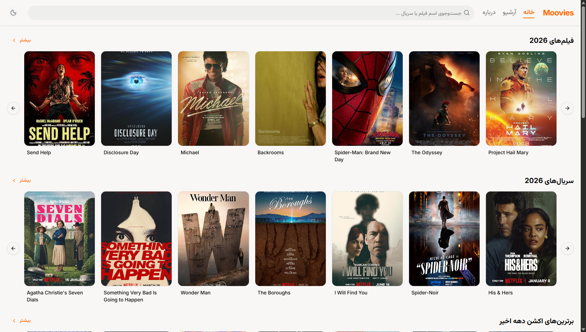
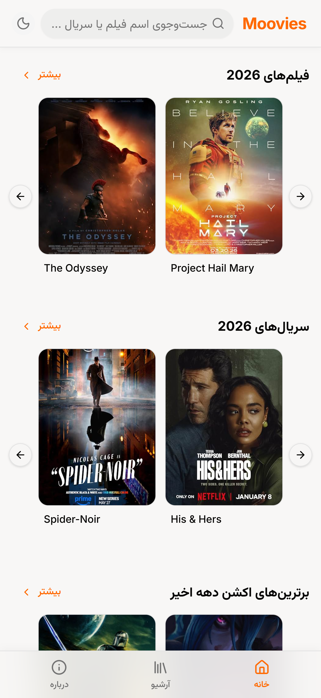

# Moovies

A SPA web client to search, filter, sort and brows movies and series data based on free community film archive.

## Table of Contents

- [Overview](#overview)
- [Screenshots](#screenshots)
- [Tech Stack](#tech-stack)
- [Key Features](#key-features)
- [How It Works](#how-it-works)
- [Getting Started](#getting-started)
  - [Prerequisites](#prerequisites)
  - [Installation](#installation)
- [Attribution](#attribution)
- [License](#license)

## Overview

I initially created **Moovies** during [first internet blackout in Iran due to national protests](https://en.wikipedia.org/wiki/2026_Internet_blackout_in_Iran) based on DonyayeSerial free archive to provide a beautiful UI for film links.  
I intended to build it for personal use of my family, friends and colleagues to brows, search, filter and sort DonyayeSerial movies data. And I wanted it to be client/front-end only to be easier to deploy and host.  
Back then and still DonyayeSerial publishes their film archive in their [telegram channel](https://t.me/donyayeserialtel) as a single html file without a proper UI. So I decided to design a more user friendly UI based on their data.  
Later the internet shut down continued after [US and Isreal attacked Iran](https://en.wikipedia.org/wiki/2026_Iran_war) so I had more time in home and developed it more to have better features and design.

## Screenshots

| Desktop | Mobile |
|---------|--------|
|  |  |


[Live Site](https://moovies.ir)

## Tech Stack

- **React** 19
- **React Router** 8
- **Vite** 7
- **TypeScript** 5
- **Tailwind CSS** 4
- **shadcn/ui**
- **Python 3**

---

## Key Features

- **Client-Side Filtering**:
  - Filter by title type (Movies vs. Series).
  - Filter by audio & translation (Subtitled, Persian Dubbed, Raw).
  - Filter by IMDb rating range and vote count thresholds.
  - Multi-select genre tags.
- **Sorting**: Sort by rating, total votes, release year, or recently added.
- **On-Demand Loading**: Heavy title details are loaded only when a title is visited to keep initial bundle size small.

---

## How It Works

Moovies is built using **React Router** configured in SPA mode. There are no servers or Node runtimes required in production. Static HTML, JavaScript, and CSS bundles are served directly from edge CDNs or object storage.

Loading complete details, plots, cast lists, and download links for 22,000+ movies at once would require a 30MB+ JSON bundle, destroying mobile performance.

Instead, the project splits data into two forms:

1. **Essential Metadata (`src/assets/data.json`)**:
   Contains lightweight records (`imdb_code`, `title`, `year`, `runtime`, `imdb_rate`, `imdb_votes`, `genres`, `version_added`). This file is bundled with the client application to enable client-side search, filtering, sorting, and pagination.

2. **Detail Chunks (`public/data_chunks/chunk_000.json` ... `chunk_127.json`)**:
   Heavy fields (plot summaries, directors, writers, actors, and download links) are partitioned across 128 JSON files using a modulo hash on the title's IMDb ID.

   When a user opens a title's page, the app fetches only that single chunk and caches it in memory.

## Getting Started

### Prerequisites

- [Node.js](https://nodejs.org/) (version 20 or higher recommended)
- [npm](https://www.npmjs.com/)

### Installation

1. **Clone the repository**:

   ```bash
   git clone https://github.com/aminforouzan/Moovies.git
   cd Moovies
   ```

2. **Install dependencies**:

   ```bash
   npm install
   ```

3. **Run data pipeline to get poster and titles data**:

- Move to `/data` folder. You see a `_pipeline_example` folder in it with a file named `omdb_key_example.txt` inside it. remove the `_example` suffix from folder and file name.
- Then get your free API key from OMDB website and put your omdb API key in the now named `omdb_key.txt` file.
- Run `build_data.py` script to download IMDB tsv datasets:
  ```bash
  python build_data.py --download-tsv
  ```
  this command would download 2 files named `title.basics.tsv` and `title.ratings.tsv` from IMDB public datasets.
- Now you need to check [DonyayeSerial telegram channel](https://t.me/donyayeserialtel) to get their latest link of `one page archvive`. When you found it, Download that html file and save it to `/data` folder as `One Page Archive.html`
- run `build_data.py` script:
  ```bash
  python build_data.py
  ```
  This will clean the html file, merge it with tsv files downloaded from IMDB. Then fetches posters and titles data from OMDB.  
  When the script finishes, you get `/public/posters` folder containing poster images of all the titles. also `/public/data_chunks` folder that has 128 data chunk files for titles details.

4. **Start the local development server**:
   ```bash
   npm run dev
   ```
   Open `http://localhost:5173` in your browser.

## Attribution

- **Archive Data**: Heartfelt thanks to [DonyayeSerial](http://donyayeserial.com) for publishing and maintaining their public movie archive. If you find their archive valuable, consider supporting them [here](https://daramet.com/donyayeserial).
- **Metadata**: Film metadata and ratings are enriched using [IMDb Datasets](https://developer.imdb.com/non-commercial-datasets/) and [OMDb API](https://www.omdbapi.com/).

## License

Distributed under the **MIT License**. See `LICENSE` for more information.
